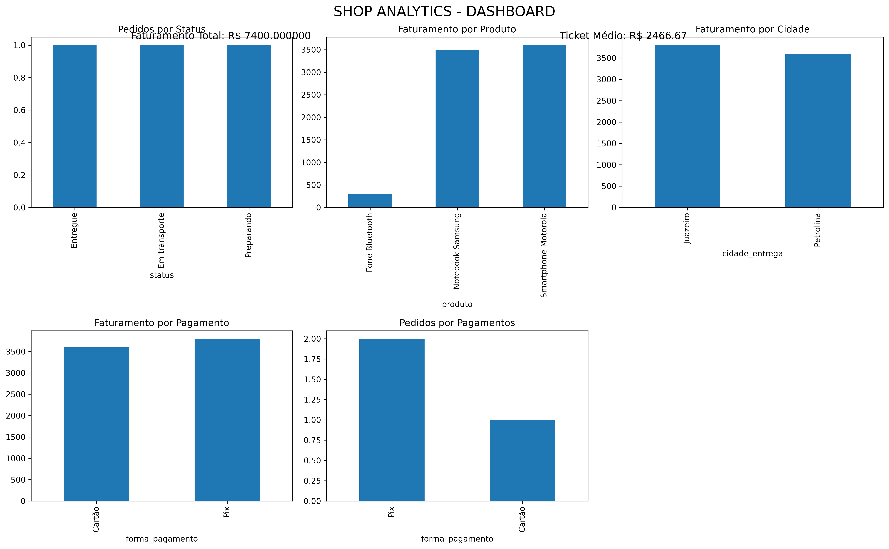

eShop Brasil — Sistema de Gestão e Análise de Dados

1. Introdução

O eShop Brasil é um projeto acadêmico desenvolvido para demonstrar a aplicação de tecnologias de Banco de Dados e Big Data em uma empresa de comércio eletrônico.

A solução utiliza MongoDB para armazenamento de dados, Python para manipulação e análise das informações e Streamlit para disponibilizar uma interface visual e interativa.

2. Problema e objetivos

Com o crescimento das vendas online, empresas precisam lidar com grandes volumes de informações sobre clientes, pedidos e produtos.

O projeto tem como objetivo desenvolver uma aplicação capaz de:

* Armazenar e consultar dados de clientes, pedidos e produtos.
* Cadastrar, editar e excluir produtos.
* Integrar informações de diferentes coleções.
* Realizar análises de vendas e comportamento dos pedidos.
* Apresentar indicadores e gráficos para apoiar decisões.
* Demonstrar o uso de containers Docker e banco de dados NoSQL.

3. Tecnologias utilizadas

Tecnologia	Aplicação
Python	Lógica e manipulação dos dados
MongoDB 8.0	Banco de dados NoSQL
PyMongo	Conexão entre Python e MongoDB
Pandas	Manipulação e integração de dados
Matplotlib	Geração de gráficos
Streamlit	Interface visual interativa
Docker	Containerização da aplicação
Docker Compose	Gerenciamento dos containers

4. Estrutura do banco de dados

O projeto utiliza o banco shop_analytics, organizado em três coleções principais:

* clientes: informações dos clientes.
* pedidos: informações das compras realizadas.
* produtos: informações dos produtos comercializados.

O MongoDB permite armazenar documentos de maneira flexível, utilizando o formato BSON, baseado em estruturas semelhantes ao JSON.

5. Funcionalidades da aplicação

A interface desenvolvida em Streamlit permite:

* Visualizar os dados cadastrados.
* Consultar clientes, pedidos e produtos.
* Cadastrar novos produtos.
* Editar produtos existentes.
* Excluir produtos com confirmação.
* Integrar informações de pedidos e produtos.
* Consultar pedidos por cidade de entrega.
* Visualizar gráficos de distribuição dos pedidos por status.
* Acompanhar indicadores gerais do sistema.

A aplicação também utiliza técnicas de pseudonimização na exibição de determinadas informações pessoais.

6. Integração e manipulação dos dados

A integração entre pedidos e produtos é realizada utilizando Pandas, por meio da operação merge.

Essa operação permite relacionar informações das diferentes coleções e apresentar dados como produto, categoria, quantidade, valor total, estoque, cidade de entrega e status do pedido.

Os dados integrados também são utilizados para gerar visualizações e apoiar análises operacionais.

7. Execução com Docker

O projeto utiliza Docker Compose para executar os serviços do MongoDB e da aplicação Streamlit.

Requisitos

* Docker Desktop instalado.
* Docker Compose disponível.
* Python 3.11 ou superior (para execução local).

Configuração das variáveis de ambiente

Crie um arquivo .env na pasta do projeto com as variáveis de conexão necessárias:

* MONGO_URI: conexão para execução local.
* MONGO_URI_DOCKER: conexão utilizada pelo container Streamlit.

As credenciais devem ser configuradas localmente e nunca publicadas no repositório.

Construção e inicialização

Na pasta do projeto, execute:

docker compose up -d --build

Para verificar os containers:

docker compose ps

Para acessar a aplicação, abra:

http://localhost:8501

Para visualizar os logs:

docker compose logs -f

Para parar os serviços sem excluir os volumes de dados:

docker compose down

8. Execução local

Também é possível executar a aplicação diretamente no computador.

Instale as dependências:

pip install -r requirements.txt

Execute:

streamlit run app.py

O MongoDB deve estar em execução e a variável MONGO_URI deve estar configurada corretamente.

9. Segurança e privacidade

O projeto considera princípios de segurança e privacidade relacionados à Lei Geral de Proteção de Dados (LGPD).

Entre as medidas demonstradas estão:

* Uso de usuário específico para acesso da aplicação ao banco.
* Separação das credenciais em variáveis de ambiente.
* Exclusão do arquivo .env do controle de versão.
* Pseudonimização de determinadas informações pessoais nas visualizações.

Essas medidas representam uma demonstração acadêmica de boas práticas, não uma certificação de conformidade integral com a LGPD.

10. Big Data e possibilidades de expansão

O projeto utiliza MongoDB e Pandas para demonstrar armazenamento, integração e análise de dados.

Em um cenário de crescimento da eShop Brasil, tecnologias como Apache Hadoop e Apache Spark poderiam ser incorporadas para processamento distribuído de grandes volumes de dados.

Também poderiam ser implementados sistemas de recomendação personalizados, análise de comportamento de compra e otimização de rotas de entrega.

11. Estrutura dos arquivos

shopAnalytics/
│
├── app.py
├── analises.py
├── conexao.py
├── requirements.txt
├── Dockerfile
├── docker-compose.yml
├── .dockerignore
├── .gitignore
├── .env
└── dashboard_shop_analytics.png

O arquivo .env é utilizado localmente e não deve ser enviado ao GitHub.

## Demonstração da aplicação
### Tela inicial

### Gerenciamento de produtos

### Pedidos e integração

### Dashboard de análise de dados

12. Considerações finais

O projeto eShop Brasil demonstra como tecnologias de banco de dados NoSQL, Python, análise de dados e containers podem ser integradas para desenvolver uma solução de gestão e análise de informações em uma empresa de comércio eletrônico.

A aplicação permite visualizar informações relevantes para a tomada de decisões e apresenta possibilidades de expansão para cenários de Big Data.

⸻

Projeto acadêmico — Aplicação Prática de Tecnologias de Banco de Dados e Big Data.